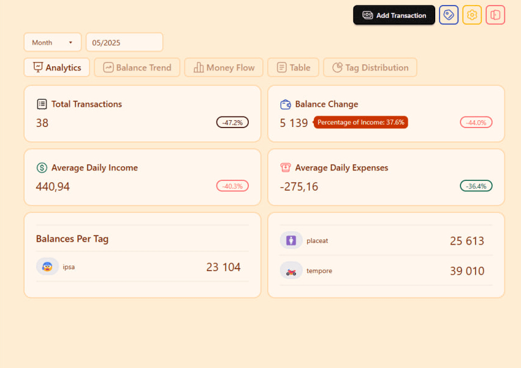
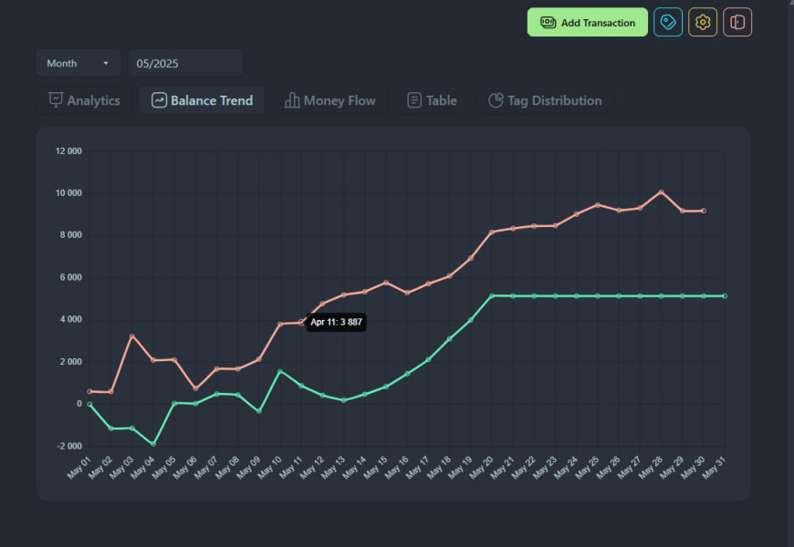
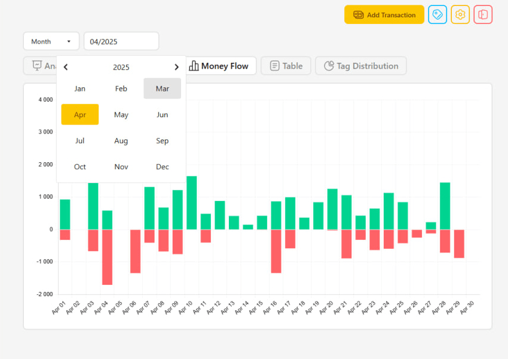
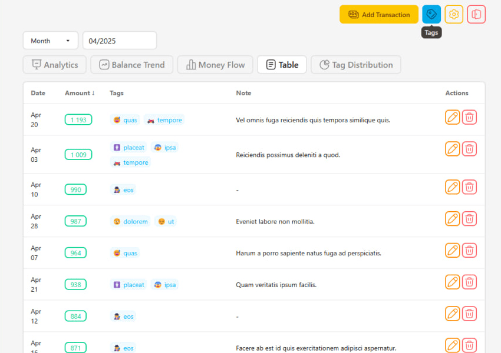
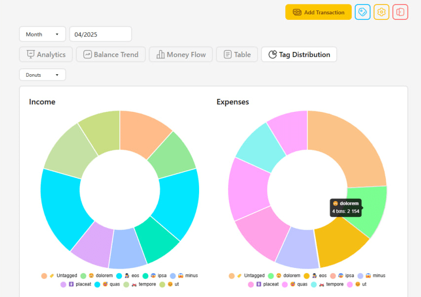
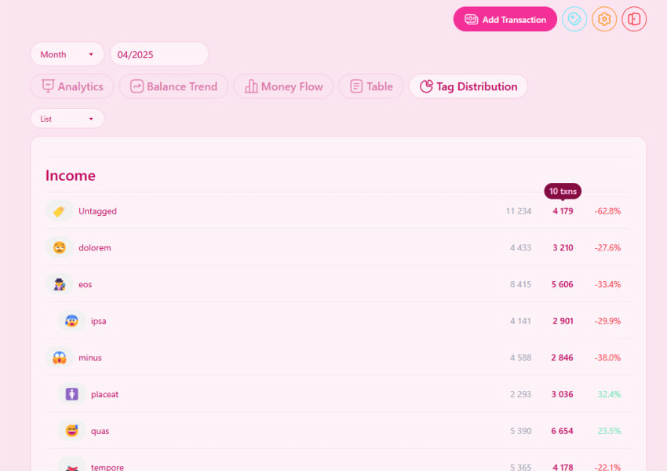
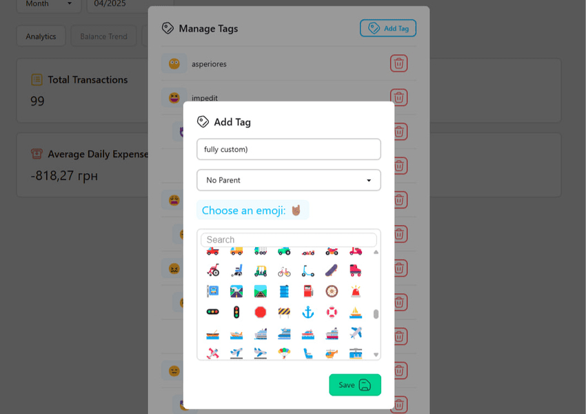
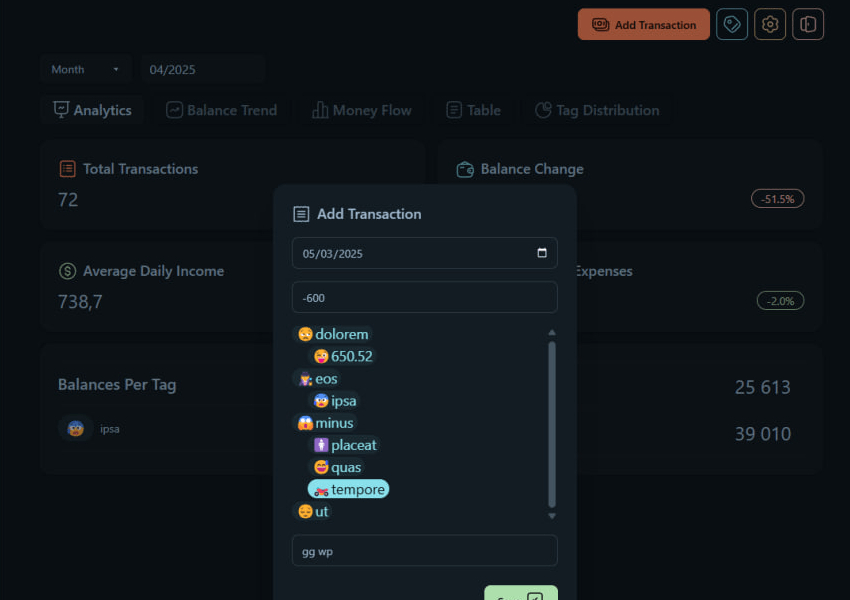

# FundsFlow

Personal finance tracker

## Features

- Transactions:
  - date, amount, tags, note
  - optional file attachments (JPEG / PNG / WebP / PDF, several per transaction)
  - source: web, Telegram, recurring, or MCP
- Recurring transactions:
  - daily, weekly, monthly, yearly
  - ends after a date or a set number of times
- Budgets:
  - per-tag spending limits
  - pause/resume, full history of past limits
- Tags:
  - fully customizable, with emojis 😋
  - hierarchical (parent/child)
- Telegram bot:
  - quick-add by chatting
  - photo / PDF receipt with caption (e.g. `-350 groceries`)
  - bot-first registration/login
  - Mini App (Web UI) with auto-login when Telegram is linked
  - send attachments and PDF reports to the chat
  - budget and digest alerts, mute/unmute
- MCP (AI clients):
  - personal token + connection URL in Settings
  - create / update transactions, attach files (base64 or source_url), budgets, tags, export

- Filter:
  - by date: week, month, year
  - by tags (header filter + Untagged, List and insights)
  - search notes (List tab)
- Calendar:
  - month / week / year views
  - actual transactions + upcoming recurring
  - attachment indicator on items
- Onboarding:
  - welcome modal with starter tags preview
  - optional Telegram bot link
- Settings:
  - money / date format
  - 30+ themes (favorites)
  - Accounts: Telegram link, MCP token / connection URL
  - Report: print / save PDF of selected insight tabs (or send to Telegram)
  - JSON account export
- Helpful Insights (tabs):
  - Analytics — totals, averages, balances per tag
  - Calendar — day grid + upcoming
  - Budgets — limits and progress
  - Tags — distribution (donuts / list)
  - Flow — income vs expenses over time
  - Trend — running balance
  - List — searchable / filterable table (source + attachments)

|  |  |  |
| ---------- | ---------- | ---------- |
|  |  |  |
|  |  |  |
|  |  |  |

## Report PDF (Gotenberg)

One renderer for every report PDF: Settings → Report (download / Send to Telegram), the assistant report card and the Telegram `send_report` tool all call the API (`POST /api/report`, `POST /api/agent/report`). The API mints a one-time, read-only token (120 s, ability `report:print`) and asks [Gotenberg](https://gotenberg.dev) Chromium to open the real SPA in print mode (`REPORT_RENDER_URL/?print=report#t=…`), so the PDF uses the user's theme and the real Chart.js charts. If `REPORT_RENDER_URL` is empty or the render fails, the API falls back to its plain server-side HTML report.

- Local: `docker compose -f docker/compose.gotenberg.yml up -d`, then in `backend/.env` set `GOTENBERG_URL=http://127.0.0.1:3000` and `REPORT_RENDER_URL` to a frontend URL reachable *from the Gotenberg container* (or leave it empty for the HTML fallback)
- Dokploy: add service image `gotenberg/gotenberg:8` (`--chromium-disable-javascript=false --api-timeout=120s`) on the same network as the backend; on the backend set `GOTENBERG_URL=http://<service>:3000` and `REPORT_RENDER_URL=https://<your frontend domain>`. Gotenberg needs outbound access to that frontend and to the API origin in the frontend's `VITE_API_URL`, and `CORS_ALLOWED_ORIGINS` must include the frontend origin

## Admin panel (Filament)

A [Filament](https://filamentphp.com) panel lives on the API host at `/admin` (e.g. `https://api.fundsflow.fun/admin`). It is for operators only: users list and detail (read-only transactions, tags, budgets, recurring), per-user AI limit / bonus / reset, block and unblock, admin role, a dashboard with stats and an audit log of every admin action (`admin_audit_logs` table plus `admin.*` log lines).

- Access: only users with `is_admin` and no `blocked_at`; TOTP two-factor is required (set up on first sign-in, recovery codes shown once)
- Grant or revoke: `php artisan admin:grant you@example.com [--password] [--revoke] [--reset-mfa]`. `--password` sets a sign-in password (Google/Telegram-only accounts have none you know); `--reset-mfa` clears a lost authenticator
- AI limit: `AI_RECEIPT_DAILY_LIMIT` is the server default; `users.ai_daily_limit` overrides it per user (empty means the default, 0 turns AI off for that user). A bonus from the panel adds to today only
- Blocking (`users.blocked_at`) rejects API tokens, password/OAuth sign-in and Telegram messages
- Env (backend): `SESSION_DRIVER=redis`, `SESSION_DOMAIN=<api host>`, `SESSION_SECURE_COOKIE=true`, and `APP_URL=https://<api host>` (asset and Livewire URLs are built from it). Only `/admin` and `/livewire-*` start a session; the API, CORS and the Telegram webhook are unchanged
- Deploy: the image publishes the panel's JS/CSS during `composer install` (`filament:upgrade`); migrations are not automatic, so run `php artisan migrate --force` in the backend container after the first deploy, then `admin:grant`
