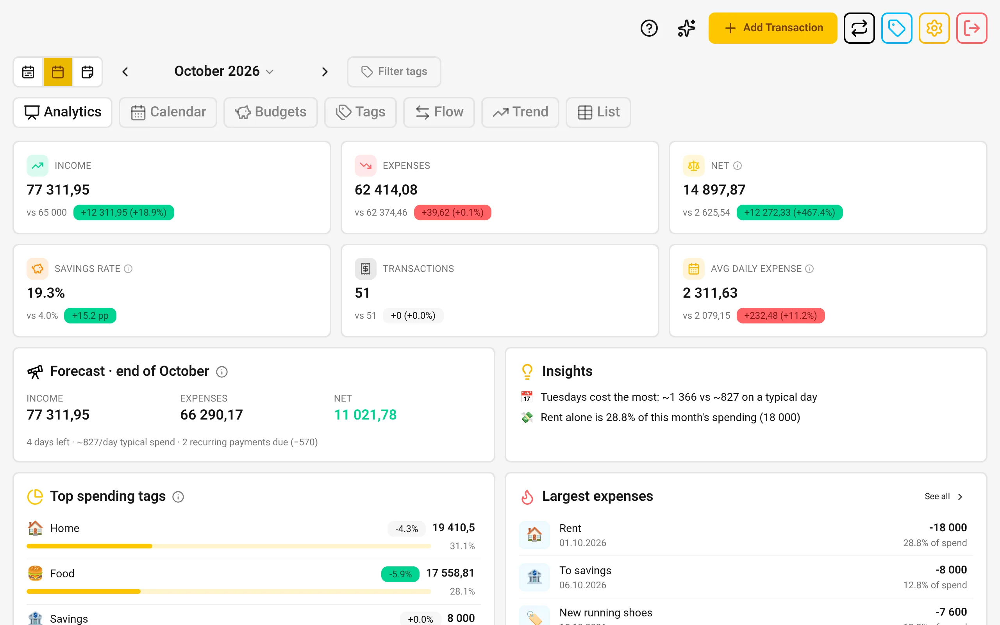
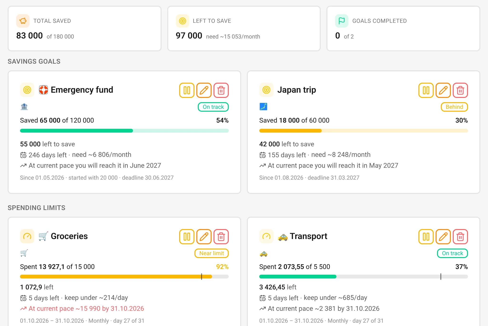
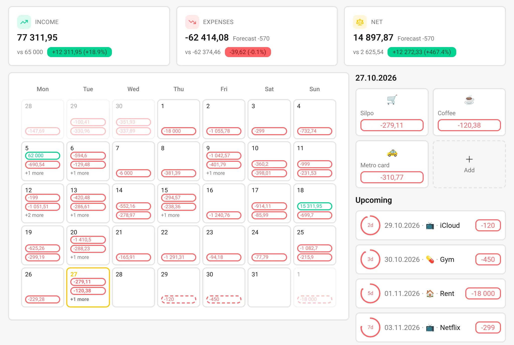
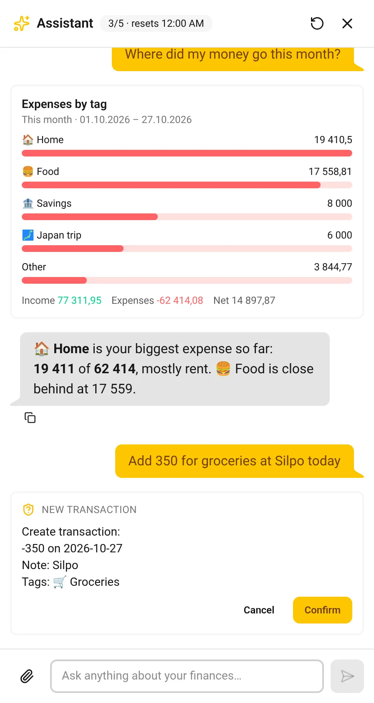

# FundsFlow


A personal finance tracker with an AI assistant on the web and in Telegram: log spending by chatting, importing receipts or speaking, then see where your money goes.

[App](https://fundsflow.fun) · [Telegram bot](https://t.me/funds_flow_bot) · [Docs](https://fundsflow.fun/docs/) · [What's new in 2.0](https://fundsflow.fun/docs/whats-new/) · [Releases](https://github.com/Loafer19/FundsFlow/releases) · [MIT License](./LICENSE)

## Highlights

- **AI assistant** in the web app (`/`, `Ctrl+K` / `⌘K`) and in Telegram, with shared memory across both
- **Import anything**: receipt photos, voice messages, PDF, DOCX, CSV/XLSX/ODS, JSON, OFX/QIF, HTML and screenshots
- **Budgets** with per-tag limits, limit history and savings goals with a deadline and pace
- **Analytics** across Analytics, Flow, Trend, Calendar, Tags and List tabs, with forecasts and period comparison
- **Recurring transactions**: daily, weekly, monthly or yearly, ending on a date or after N times
- **Telegram bot + Mini App**: quick-add, receipts, charts, budget alerts and weekly digests
- **MCP server** so your own AI client (Claude, Cursor, Grok, …) can read and edit your finances
- **Themed PDF reports** with real charts, downloaded or sent to Telegram, in 30+ themes

## Screenshots

<table>
<tr>
<td width="50%"><picture><source media="(prefers-color-scheme: dark)" srcset="./.github/screenshots/2.0/app-analytics-dark.webp"></picture></td>
<td width="50%"><picture><source media="(prefers-color-scheme: dark)" srcset="./.github/screenshots/2.0/app-budgets-dark.webp"></picture></td>
</tr>
<tr>
<td width="50%"><picture><source media="(prefers-color-scheme: dark)" srcset="./.github/screenshots/2.0/app-calendar-dark.webp"></picture></td>
<td width="50%"><picture><source media="(prefers-color-scheme: dark)" srcset="./.github/screenshots/2.0/app-assistant-dark.webp"></picture></td>
</tr>
</table>

## Tech stack

- **Backend:** Laravel (PHP 8.4), FrankenPHP, MySQL, Redis, Filament admin, xAI Grok
- **Frontend:** Vue 3, Pinia, DaisyUI 5 / Tailwind CSS 4, Chart.js, Vite, Bun, Biome
- **MCP:** Bun + TypeScript, Streamable HTTP
- **Docs & landing:** Astro (Starlight for docs)
- **Ops:** Docker, Caddy, Gotenberg (PDF), Dokploy

## For developers

Repository layout:

```text
backend/   Laravel API, Filament admin (/admin), Telegram bot, Grok agent
frontend/  Vue 3 SPA (web app + Telegram Mini App)
mcp/       MCP server for AI clients (own container)
docs/      Astro Starlight docs, served at /docs
landing/   Astro landing page, served at /landing
docker/    Dockerfiles (backend, frontend, mcp), Caddyfiles, compose.gotenberg.yml
```

Run locally (PHP 8.4, Composer, Bun, MySQL and Redis):

```sh
# API
cd backend && composer install && cp .env.example .env
php artisan key:generate && php artisan migrate
php artisan serve            # plus `php artisan queue:work` for Telegram updates

# Web app (set VITE_API_URL in frontend/.env, see frontend/.env.example)
cd frontend && bun install && bun run dev

# MCP server (needs mcp/.env)
cd mcp && bun install && bun run dev

# Docs / landing
cd docs && bun install && bun run dev
cd landing && bun install && bun run dev

# Optional: Gotenberg for themed report PDFs
docker compose -f docker/compose.gotenberg.yml up -d
```

Configuration (env vars, Telegram, MCP, AI) is covered in the [docs](https://fundsflow.fun/docs/).
The backend Docker image runs `php artisan migrate --force` on container start (it waits up to ~30s for the database); set `AUTO_MIGRATE=false` to opt out and run it by hand.

## Self-hosting

Report PDFs are rendered by Gotenberg from the real app — see [Report PDF (Gotenberg)](https://fundsflow.fun/docs/self-hosting/report-pdf/). The operator-only Filament panel at `/admin` on the API host is described in [Admin panel (Filament)](https://fundsflow.fun/docs/self-hosting/admin-panel/).

## License

FundsFlow is released under the [MIT License](./LICENSE). Copyright (c) 2026 Ruslan Popelyshyn.
